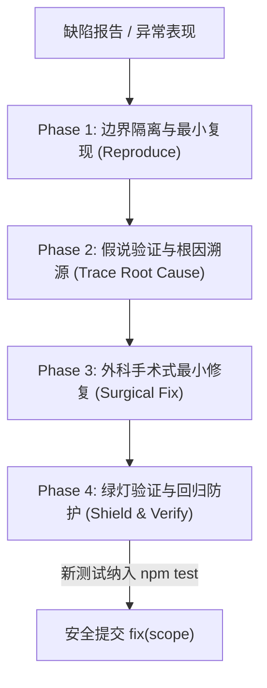

# 系统化根因排错与调试助手 (systematic-debugging)

> 本技能为 **Chillin 数字花园** 的根因排错铁律手册，吸收自开源著名 AI 编程规范 **`obra/superpowers`** 的核心方法论。其唯一宗旨是：**彻底根除“盲猜打补丁（Shotgun Debugging）”，坚持以证据和根因为核心的科学调试闭环**。

---

## 1. 调试绝对铁律 (Iron Laws of Debugging)

1. **严禁在没有复现与确凿证据前盲改代码 (No Fix Without Root Cause)**：
   * 绝对禁止靠直觉“试一试”、“加个 try/catch 看看能不能跑”、“先改改这一行试试”；
   * 盲目打补丁不仅解决不了根因，还会掩盖真正的逻辑漏洞，引入新的隐蔽回归。
2. **永远建立最小复现基线 (Reproduce First)**：
   * 优先编写一个能重现该缺陷的最小测试用例（在 `tests/` 下编写原生 `node:test`），或者设计一个确定性的本地复现步骤。
3. **外科手术式最小修复 (Surgical Fix)**：
   * 修复必须直击根因，改动行数与影响面保持最小，严禁借修 Bug 之名顺手大改无关代码。

---

## 2. 系统化调试四步闭环协议 (The 4-Phase Protocol)

### Phase 1: 边界隔离与最小复现 (Isolate & Reproduce)
- **划定故障域**：通过报错堆栈与网络请求，确定问题属于哪个领域：
  - `A. 前端视图与交互`（DOM 渲染、CSS、输入法躲避）
  - `B. 客户端存储与离线`（Service Worker、IndexedDB、localStorage）
  - `C. 同步与裁决逻辑`（`sync.js`、`toUpdatedTs`、LWW、Dirty Delta）
  - `D. 边缘后端网关`（`workers/api.js`、鉴权、CORS、网关路由）
  - `E. D1 数据库与事务`（SQL 查询、参数绑定、软删除、外键级联）
- **编写最小失败测试 (Red Test)**：
  在 `tests/` 对应测试文件中，用最精炼的数据重现该错误输入。运行该测试应稳定抛错。

### Phase 2: 假说验证与根因溯源 (Formulate & Prove Hypotheses)
- 明确写出 1~2 个可能的根本原因假设；
- **寻找确凿证据**：通过打印变量实际运行值、查看 D1 返回结构或分析网络报文，**证实或证伪假设**；
- 问自己：“如果这个假设是对的，为什么之前没报错？为什么在这组特定输入下才报错？”

### Phase 3: 外科手术式最小修复 (Surgical Fix)
- 仅修改引起根因的那几行代码；
- 严禁通过外层吞掉异常（如空的 `catch {}`）来伪装成功；
- 检查是否破坏了 Worker 300 行网关限制或模块 500 行上限。

### Phase 4: 绿灯验证与回归防护 (Shield & Verify)
- 运行 Phase 1 编写的复现单测 -> **必须由红转绿 (Green)**；
- 运行全局单测套件 `npm test` -> **68+ 项测试必须 100% 绿灯通过**；
- 若涉及 Worker，运行 `npx wrangler deploy --dry-run` 确保打包无误；
- 将新增的测试用例永久固化在测试库中，防止未来的重构破坏此边界。

---

## 3. Chillin 专属高频疑难杂症排查指南

| 故障现象 | 最常见根因 (Root Cause) | 排查切入点与工具 |
| :--- | :--- | :--- |
| **离线启动报 `Uncaught SyntaxError: <`** | `public/sw.js` 错误将某个 JS 模块降级回退为了 `/index.html` | 检查 `tests/sw.test.mjs`，核实请求 URL 是否命中了 `isModuleJs` 分支 |
| **D1 查询返回空或主键索引失效** | 绑定参数传了字符串而不是整数（如 `'123'` 代替 `123`） | 检查传入 `db.prepare().bind(...)` 前是否经过 `Number(id)` 转换 |
| **增量同步后本地修改丢失** | 客户端与云端时间戳未对齐或缺少东八区偏移 | 检查 `toUpdatedTs` 是否正确解析了包含或缺少时区的字符串 |
| **新建记录离线同步时被丢弃** | 离线新建未及时分配临时 ID，导致脏数据选择器过滤失效 | 检查是否调用了 `ensureLocalId`，查阅 `tests/sync.test.mjs` |
| **Web Push 订阅发送报 404/410** | 用户的浏览器已撤销通知权限或注销了 Service Worker | 必须在 `sendEdgePush` 中捕获并从 `push_subscriptions` 物理删除该端点 |
| **前端新增模块离线白屏** | 新建了 `public/js/foo.js` 但忘记在 `sw.js` 的 `ASSETS` 中登记 | 运行 `node --test tests/sw.test.mjs`，单测会自动指出缺失的模块路径 |
