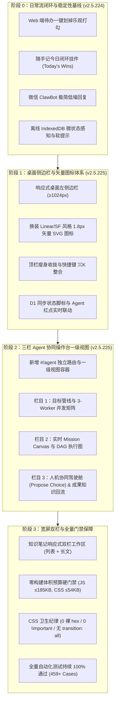
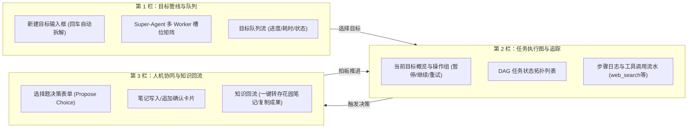

# Chillin 数字花园 · 落地实施路线图各阶段操作与演进手册

> **文档归档路径**：`docs/archive/落地实施路线图_各阶段操作与演进操作手册.md`  
> **基准版本**：`v2.5.225`（包含桌面侧边栏工作台与三栏 Agent 协同操作台）  
> **适用范围**：工程研发、UI/UX 迭代、运维发版、多端日常演练与架构审计  

---

## 目录

- [一、背景与架构演进初衷](#一背景与架构演进初衷)
- [二、落地实施总体路线图全景](#二落地实施总体路线图全景)
- [三、阶段 0：日常流闭环与稳定性加固（操作与落地指南）](#三阶段-0日常流闭环与稳定性加固操作与落地指南)
- [四、阶段 1：桌面侧边栏与矢量图标体系（重构框架操作指南）](#四阶段-1桌面侧边栏与矢量图标体系重构框架操作指南)
- [五、阶段 2：三栏 Agent 协同操作台一级视图（核心实现指南）](#五阶段-2三栏-agent-协同操作台一级视图核心实现指南)
- [六、阶段 3：响应式宽屏优化、双栏编辑器与工程门禁（质量守门指南）](#六阶段-3响应式宽屏优化双栏编辑器与工程门禁质量守门指南)
- [七、运维发版、数据备份与容灾恢复演练手册（Runbook）](#七运维发版数据备份与容灾恢复演练手册runbook)
- [八、常见异常排查与自愈预案（Troubleshooting）](#八常见异常排查与自愈预案troubleshooting)

---

## 一、背景与架构演进初衷

Chillin 数字花园经历多次迭代后，已构建出基于 **Cloudflare Workers + D1 (SQLite) + R2 对象存储** 的高弹性边缘全栈系统。然而在日常高频使用与深度探索过程中，产品面临两个核心阶段性挑战：

1. **日常使用的“摩擦力”（Usability Friction）**：
   - 传统模式下，待办划掉需要经过“进入详情 → 编辑文本 → 手动将 `[ ]` 改为 `[x]` → 保存”的冗长步骤；
   - 微信端机器人通知信息过载，操作确认伴随冗长散文；
   - 弱网与网络断流时，缺乏直观的本地状态感知。
2. **Web 端体验与智能体协同割裂（Workspace & Agent Decoupling）**：
   - 桌面端（$\ge 1024\text{px}$）仍沿用传统小屏移动端顶部通栏，屏幕两侧大量留白造成空间浪费；
   - 原有导航依赖粗糙的 Emoji（🌿、⚡️、📝、🔖、📖），缺乏专业级软件（如 Linear、Raycast、Apple SF Symbols）的凝练质感；
   - 自主智能体（Super-Agent）局限在简陋的弹出浮层模态框中，无法展示多 Worker 并发拓扑、工具调用追踪与人机拍板闭环。

为此，团队确立了**“以极简丝滑的日常处理为基底，稳步落地桌面工作台与 Agent 独立操作台”**的落地实施路线图。

---

## 二、落地实施总体路线图全景



---

## 三、阶段 0：日常流闭环与稳定性加固（操作与落地指南）

### 1. 目标与交付物
保证高频日常“记录 → 待办 → 提醒 → 划销 → 复盘”闭环秒级完成，杜绝消息丢失、重复提醒与操作繁琐。

### 2. 具体操作实现细节

#### 2.1 Web 端待办「一键打勾划销」乐观交互
* **核心文件**：[`public/js/feeds.js`](file:///d:/7/chillin/public/js/feeds.js)
* **实现原理**：
  - 正文解析：扫描正文行首 `[ ]` 或 `[x]`，将其动态替换为具有语义属性的复选按钮：
    ```html
    <button type="button" class="feed-todo-checkbox" data-feed-id="123" data-todo-line="0" aria-label="标记完成">
      <span class="feed-todo-box"></span>
    </button>
    ```
  - 乐观更新与防抖：点击后立即反转 DOM 样式并播放划掉动效，异步批量提交 `/api/sync/batch`，网络异常时自动回滚。

#### 2.2 今日看板闭环挂件（Today's Wins Widget）
* **核心文件**：[`public/js/feeds.js`](file:///d:/7/chillin/public/js/feeds.js)、[`public/style.css`](file:///d:/7/chillin/public/style.css)
* **实现原理**：
  - 动态聚合当日随手记中的全部待办项（未完成 `[ ]` 与今日已完成 `[x]` / `✅`）；
  - 顶部清晰显示当前进度百分比与剩余项数，支持在看板区域一键划销。

#### 2.3 微信 ClawBot 低噪声即时确认
* **核心文件**：[`workers/src/bot-commands.js`](file:///d:/7/chillin/workers/src/bot-commands.js)
* **纪律约束**：单文件严格遵守 $\le 500$ 行架构红线（当前 495 行）。
* **操作要点**：
  - 剔除以往长段落散文解释；
  - 快速完成确认统一收敛为单行响应，例如：
    ```text
    ✅ 已完成待办：买牛奶（今日已达成 4/5 项）
    ```

#### 2.4 离线韧性与微状态感知
* **核心文件**：[`public/index.html`](file:///d:/7/chillin/public/index.html)、[`public/style.css`](file:///d:/7/chillin/public/style.css)
* **操作要点**：
  - 顶部离线通知条引入 Apple HIG 风格悬浮柔和设计（`#offline-bar`），当处于断网或飞行模式时给出安心提示：“本地已持久化，联网自动增量同步”，杜绝给用户空白无响应的错觉。

---

## 四、阶段 1：桌面侧边栏与矢量图标体系（重构框架操作指南）

### 1. 目标与交付物
将桌面端（$\ge 1024\text{px}$）升级为现代化桌面工作台布局；彻底淘汰粗糙 Emoji，建立 1.8px 细线矢量 SVG 图标体系。

### 2. 具体操作实现细节

#### 2.1 结构注入（DOM 层）
在 [`public/index.html`](file:///d:/7/chillin/public/index.html) 中顶部注入固定侧边栏容器 `<aside class="app-desktop-sidebar">`：
```html
<aside class="app-desktop-sidebar" id="app-desktop-sidebar" aria-label="桌面侧边导航">
    <div class="sidebar-top">
        <div class="sidebar-brand">
            <!-- 品牌 SVG 图标 -->
            <span class="sidebar-brand-text">Chillin</span>
            <span class="sidebar-version-badge" data-app-version>v2.5.225</span>
        </div>
        <div class="sidebar-nav-group">
            <div class="sidebar-nav-title">数字花园</div>
            <a href="#" class="sidebar-nav-item nav-item active" data-view="home" aria-current="page">...</a>
            <a href="#" class="sidebar-nav-item nav-item" data-view="feeds">...</a>
            <a href="#" class="sidebar-nav-item nav-item" data-view="notes">...</a>
            <a href="#" class="sidebar-nav-item nav-item" data-view="bookmarks">...</a>
            <a href="#" class="sidebar-nav-item nav-item" data-view="reader">...</a>
        </div>
        <div class="sidebar-nav-group sidebar-nav-group--agent">
            <div class="sidebar-nav-title">自主智能体</div>
            <a href="#/agent" class="sidebar-nav-item nav-item sidebar-agent-item" id="sidebar-btn-agent-goals" data-view="agent" aria-label="Agent 操作台">
                <!-- 机器人矢量 SVG -->
                <span class="sidebar-item-label">Agent 操作台</span>
                <span class="sidebar-agent-badge" id="sidebar-agent-badge" hidden>0</span>
            </a>
        </div>
    </div>
    <div class="sidebar-bottom">
        <div class="sidebar-status-row">
            <span class="sidebar-status-left">D1 增量同步</span>
            <span class="sidebar-status-pill">OK</span>
        </div>
    </div>
</aside>
```

#### 2.2 响应式断点与零 `!important` 布局切换
* **核心文件**：[`public/style.css`](file:///d:/7/chillin/public/style.css)
* **排版约束**：
  ```css
  /* 移动端与平板（<1024px）默认隐藏侧边栏 */
  .app-desktop-sidebar {
    display: none;
  }

  /* 桌面端（≥1024px）在非未登录且非沉浸阅读模式下激活侧边栏 */
  @media (min-width: 1024px) {
    body:not(.not-authenticated):not(.in-reader-book) .app-desktop-sidebar {
      display: flex;
      flex-direction: column;
      justify-content: space-between;
      position: fixed;
      top: 0;
      left: 0;
      bottom: 0;
      width: 220px;
      background: var(--card-bg);
      border-right: 1px solid var(--surface-hairline);
      padding: 16px 12px 14px;
      box-sizing: border-box;
      z-index: var(--z-nav);
      user-select: none;
    }

    body:not(.not-authenticated):not(.in-reader-book) .super-navbar {
      left: 220px;
      width: calc(100% - 220px);
    }

    body:not(.not-authenticated):not(.in-reader-book) .super-navbar__menu,
    body:not(.not-authenticated):not(.in-reader-book) .nav-brand-desktop {
      display: none;
    }

    body:not(.not-authenticated):not(.in-reader-book) .notion-app {
      margin-left: 220px;
      max-width: 1100px;
      padding: 76px 28px 60px;
    }
  }
  ```

#### 2.3 状态联动与红点响应
* **核心文件**：[`public/js/agent-goals.js`](file:///d:/7/chillin/public/js/agent-goals.js)
* **实现细节**：
  在 `updatePendingBadge(count)` 中同时维护移动端弹层角标和桌面侧边栏角标：
  ```javascript
  function updatePendingBadge(count) {
      const n = Math.max(0, Number(count) || 0);
      const text = n > 99 ? '99+' : String(n);
      if (badgeEl) {
          badgeEl.textContent = text;
          badgeEl.hidden = n === 0;
      }
      const sidebarBadge = document.getElementById('sidebar-agent-badge');
      if (sidebarBadge) {
          sidebarBadge.textContent = text;
          sidebarBadge.hidden = n === 0;
      }
  }
  ```

---

## 五、阶段 2：三栏 Agent 协同操作台一级视图（核心实现指南）

### 1. 目标与交付物
把 Agent 升格为一级沉浸式路由（`#/agent`），提供**目标管线、任务 DAG 执行图与人机协同驾驶舱**的三栏宽屏 Studio 工作区。

### 2. 具体操作实现细节

#### 2.1 路由层升级与懒加载
* **核心文件**：[`public/js/router.js`](file:///d:/7/chillin/public/js/router.js)
* **操作要点**：
  1. `MAIN_VIEWS` 扩充：
     ```javascript
     const MAIN_VIEWS = new Set(['home', 'feeds', 'notes', 'bookmarks', 'reader', 'agent']);
     ```
  2. 动态路由映射与路由级动态 import：
     ```javascript
     if (route.view === 'agent') {
         loadFeature('agent-goals')
             .then(() => switchView('agent', { skipHistory: true }))
             .catch((err) => { warnLazy('agent-goals')(err); switchView('home', { skipHistory: true }); });
         return;
     }
     ```
  3. 视图切换时为 `.notion-app` 施加 `.wide-workspace`，释放最大视口宽度：
     ```javascript
     if (targetViewId === 'agent') {
         mainApp.classList.add('wide-workspace');
         loadFeature('agent-goals').then(() => actions.renderAgentCockpit?.());
     } else {
         mainApp.classList.remove('wide-workspace');
     }
     ```

#### 2.2 三栏布局渲染架构
* **核心文件**：[`public/js/agent-goals.js`](file:///d:/7/chillin/public/js/agent-goals.js)



#### 2.3 关键交互：Propose Choice 拍板决策
当模型遇到技术路线选择或内容方向决策时，在第三栏动态渲染单选题卡片：
```html
<div class="cockpit-choice-card" data-approval-card="99">
  <div class="cockpit-choice-badge">⚡ 人机拍板决策 (Propose Choice)</div>
  <p class="cockpit-choice-lead">本次技术总结报告，应当重点偏向哪一个维度的实战推演？</p>
  <div class="cockpit-choice-options">
    <label class="cockpit-choice-label">
      <input type="radio" name="cockpit-choice-99" value="0" checked>
      <div><strong>方案 A：极致轻量与 Native ESM</strong></div>
    </label>
    <label class="cockpit-choice-label">
      <input type="radio" name="cockpit-choice-99" value="1">
      <div><strong>方案 B：全流程出口沙箱与 SSRF 防护</strong></div>
    </label>
  </div>
  <button type="button" class="cockpit-choice-submit" data-cockpit-decide-choice="99">
    拍板此方案并驱动继续执行 →
  </button>
</div>
```
用户点击后，调用 `decideApproval(id, 'approve', null, 'propose_choice', { choice_index })`，后端状态立即解冻，Router 继续并发推进。

---

## 六、阶段 3：响应式宽屏优化、双栏编辑器与工程门禁（质量守门指南）

### 1. 目标与交付物
全面优化长文阅读与笔记编辑体验；严守前端预算红线与自动化测试门禁，确保架构不退化。

### 2. 具体操作实现细节

#### 2.1 知识笔记（Notes）宽屏双栏方案
- **桌面模式（$\ge 1024\text{px}$）**：左侧展示分类与文章列表（固定 320px），右侧展示富文本/Markdown 编辑视口（`flex: 1`），避免传统模式下反复“列表 ↔ 详情”来回跳转；
- **小屏与手机端（$< 1024\text{px}$）**：自动降级为单栏全屏沉浸流，遵循 iOS 导航栈返回机制。

#### 2.2 前端零构建体积预算管理
* **核心文件**：[`tests/architecture.test.mjs`](file:///d:/7/chillin/tests/architecture.test.mjs)
* **预算基线表**：
  | 资源项 | 当前实测体积 | 严格预算红线 | 校验机制 |
  | :--- | :---: | :---: | :--- |
  | **JS 整体 Gzip** | 183.8 KB | $\le 185\text{ KB}$ | 自动化测试比对真实 gzip 尺寸 |
  | **CSS 整体 Gzip** | 53.1 KB | $\le 54\text{ KB}$ | 自动化测试比对真实 gzip 尺寸 |
  | **单文件 Gzip 上限** | 13.6 KB (`reader.js`) | $\le 20\text{ KB}$ | 超过必须拆分子模块或懒加载 |

#### 2.3 CSS 卫生准则与棘轮约束
* **核心文件**：[`tests/css.test.mjs`](file:///d:/7/chillin/tests/css.test.mjs)
* **四项高压线**：
  1. **零新增 `!important`**：必须维持在 227 基线内，新增样式一律依靠选择器层级提高优先级；
  2. **零裸 hex 颜色**：所有颜色必须复用 `:root` 主题令牌（如 `var(--card-bg)`、`var(--text-color)`、`rgba(var(--label-rgb), α)`）；
  3. **禁止 `transition: all`**：必须书写显式属性列表（如 `transition: background-color 0.15s ease, color 0.15s ease;`），杜绝全属性重排动画；
  4. **WCAG AA 4.5:1 对比度**：亮暗双主题下所有文本角色与表面底色均受机器审计保护。

---

## 七、运维发版、数据备份与容灾恢复演练手册（Runbook）

在落地实施的各阶段，必须严格执行规范化发版与灾备流程：

### 1. 自动化联动版本发布步骤
```bash
# 1. 运行预检脚本与全量测试套件（必须 459+ 全部通过）
npm test

# 2. 补丁发版（自动联动 package.json、SW 缓存版本、version.json 与报告）
npm run bump:patch

# 3. 部署生产 Cloudflare Workers 边缘网关
npx wrangler deploy

# 4. Git 提交并推送至远端主分支
git add -A
git commit -m "feat(release): vX.Y.Z version release description"
git push origin main
```

### 2. D1 数据库定时备份与校验
- **每日备份命令**：
  ```bash
  npm run backup
  ```
  备份文件安全存放在 `backups/chillin-d1-<时间戳>.sql.gz`，脚本自动验证 gzip 完整性并保留最近 30 天快照。
- **备份健康度校验**：
  ```bash
  npm run backup:verify
  ```

### 3. 灾难恢复演练（Disaster Recovery Drill）
> [!CAUTION]
> 恢复操作会覆盖目标数据库数据，请务必核对快照时间戳。

- **本地沙箱演练恢复**：
  ```bash
  npm run restore -- backups/chillin-d1-<时间戳>.sql.gz --local --yes
  ```
- **生产环境紧急恢复**：
  ```bash
  npm run restore -- backups/chillin-d1-<时间戳>.sql.gz --yes
  ```

---

## 八、常见异常排查与自愈预案（Troubleshooting）

| 异常现象 | 可能原因 | 诊断与排查命令 | 快速修复与自愈预案 |
| :--- | :--- | :--- | :--- |
| **Agent 状态卡在 active，Worker 不推进** | 任务已被认领但租约过期，或后端 LLM 超时 | 检查 D1 `agent_runs` 的 `lease_expires_at` | 点击卡片上的「暂停」然后点击「恢复并继续」；后台 Cron 每分钟会自动清理过期租约。 |
| **网页端新增样式在手机上不生效** | Service Worker 静态资源强缓存 | 查看 DevTools 控制台 `SW version` | 侧边栏/设置页点击「强制刷新到最新版本」，触发 SW 跳过等待并更新 Cache Storage。 |
| **外部网页抓取报 SSRF 拦截** | 目标域名指向私网或 DoH DNS 解析异常 | 审查 `workers/src/agent-web.js` 日志 | 确认为公网合规站点后重试；若目标站点有强防火墙，系统会自动降级走 Reader 代读服务预检。 |
| **本地单元测试报错 CSS 裸 hex 增长** | 在样式表中直接书写了 `#abcdef` 格式十六进制颜色 | 运行 `node --test tests/css.test.mjs` | 将色值替换为 `var(--ios-blue)` 或 `rgba(var(--label-rgb), α)` 等既有主题变量。 |

